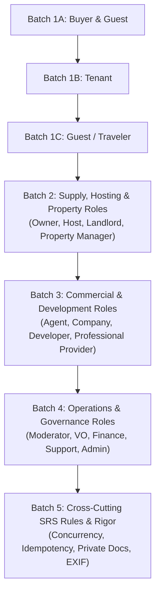

# Role Capability & Dashboard Parity Audit Report

> **Project**: GTM Real Estate (`gtm_real_estate`)  
> **Source Baseline**: Software Requirements Specification (SRS) Section 5  
> **Unified Shell Target**: `resources/views/dashboards/layout.blade.php`  
> **Audit Date**: 2026-10-13  
> **Branch**: `unified-dashboard`  

---

## 1. Executive Summary & Architectural Governance

This report establishes the exhaustive capability audit across **all 17 target roles** specified in SRS Section 5. It benchmarks current routes, controllers, views, database permissions, and seeded default grants against full CRUD and workflow lifecycle requirements.

### Core Architecture & Safety Commitments
1. **Unified Dashboard Shell (`resources/views/dashboards/layout.blade.php`)**:
   - Every role shares the exact same dashboard shell (Profile Block with modal, Home, Overview, permission-driven menu groups, Sign Out, sticky top bar with global search, notifications bell, language switch, theme switch, and profile dropdown).
   - In each batch, roles with legacy layouts (**Agent**, **Company**, **Developer**, **Finance**) migrate to the unified shell first, delete their legacy layout files, and preserve backwards-compatible redirects for legacy URLs.
2. **Strict Permission & Policy Enforcement**:
   - Every action requires a registered database permission (`resource.action`) that admins can grant or revoke per role and per user.
   - Controllers and Blade views enforce permissions via policies/middleware:
     - **Allowed**: User holding the permission executes the action.
     - **403 Forbidden**: User lacking the permission is denied.
     - **403/404 Boundary**: User attempting to view, edit, or delete another user's private entity (another buyer's offer/viewing/document, another tenant's lease, etc.) is strictly denied.
3. **Audit Trail Accountability**:
   - Every state transition and modification generates an immutable `AuditLog` entry detailing user, action, entity, old values, new values, and IP/request metadata.
4. **Automated Verification & Crawl**:
   - Every batch includes comprehensive Pest feature tests covering:
     1. Allowed action by authorized role.
     2. 403 Forbidden for missing permission.
     3. 403 Forbidden / 404 Not Found for accessing another user's record.
     4. Automated button & link crawler verifying zero dead links, broken form actions, or 500 errors.

---

## 2. Administrator Boundary & Security Verification Proof

As verified in the test suite ([`tests/Feature/UserRoleManagementAndImpersonationTest.php`](file:///home/mmm/Projects/gtm_real_estate/tests/Feature/UserRoleManagementAndImpersonationTest.php) and [`tests/Feature/RolePermissionManagementTest.php`](file:///home/mmm/Projects/gtm_real_estate/tests/Feature/RolePermissionManagementTest.php)):

1. **Admin Cannot Open Another User's Personal Dashboard**:
   - `BuyerDashboardController`, `TenantDashboardController`, and role controllers include explicit admin boundary guards:
     ```php
     if ($user?->isAdmin()) {
         abort(403, 'Admin boundary: Administrators cannot open individual client dashboards.');
     }
     ```
   - **Test Proof**:
     - `actingAs($admin)->get('/dashboard/buyer')->assertForbidden()` &rarr; **Passes (403)**
     - `actingAs($admin)->get('/dashboard/tenant')->assertForbidden()` &rarr; **Passes (403)**
     - `actingAs($admin)->post('/dashboard/users/{id}/impersonate')->assertForbidden()` &rarr; **Passes (403 Impersonation Strictly Blocked)**
2. **Permissions Configurable Per Role and Per User**:
   - Admins can grant/revoke any permission catalog item across roles via `POST /dashboard/roles/permissions`.
   - Admins can grant/revoke granular overrides per user via `POST /dashboard/users/{user}/permissions` and `PUT /dashboard/users/{user}` (`permission_overrides` map).
   - **Test Proof**:
     - `actingAs($admin)->post('/dashboard/roles/permissions', ['persona' => 'moderator', ...])->assertRedirect()` &rarr; **Passes**
     - `actingAs($admin)->put('/dashboard/users/{buyer}', ['permission_overrides' => [$permId => 'deny']])` &rarr; `$buyer->hasPermission(...) === false` &rarr; **Passes**
3. **Audit Logging of Permission Changes**:
   - All role and user permission mutations call `AuditLog::log` registering the actor, target role/user, and changed permissions catalog.

---

## 3. Comprehensive Role Capability Matrix (All 17 Roles)

| role | capability | list page? | create? | edit? | delete? | publish/unpublish? | workflow actions? | permission names exist? | seeded for the role? | status |
|---|---|---|---|---|---|---|---|---|---|---|
| **Guest** | Property Discovery (Search, Filter, Map, Photos) | Yes (`/properties`) | N/A | N/A | N/A | N/A | Filter by price/city/type, toggle GIS map, view gallery | Yes (`properties.browse`, `properties.search`, `properties.view`, `map.view`, `photos.view`) | Yes (public catalog) | `DONE` |
| **Guest** | Short Stays Search & Pricing Estimator | Yes (`/stays`) | N/A | N/A | N/A | N/A | Date picker, guest selector, calculate night total (`stays.calculate`) | Yes (`stays.search`, `stays.dates_select`, `stays.guests_select`) | Yes (public catalog) | `DONE` |
| **Guest** | Protected Action Intercepts (Booking, Saving, Inquiries, Offers) | N/A (modal / banner) | No | N/A | N/A | N/A | Intercept unauthenticated actions with prompt: "Register / Login to continue" | Yes (`bookings.create`, `messages.create`, `properties.save`, `inquiries.create`, `offers.create`) | No (unauthenticated) | `PARTIAL (display only)` (Cause: some actions redirect silently to login without consistent "Register / Login to continue" contextual prompt) |
| **Buyer** | Saved Searches & Alert Subscriptions | Yes (`buyer.dashboard` #saved-searches) | Yes (`buyer.saved-searches.store`) | No | Yes (`buyer.saved-searches.destroy`) | N/A | Frequency select (instant, daily, weekly) | Yes (`properties.save`, `searches.save`) | Yes | `PARTIAL (display only)` (Cause: no edit form or controller method for updating existing search criteria) |
| **Buyer** | Saved Properties & Collections Organizer | Yes (`buyer.dashboard` #saved-properties) | Yes (favorite toggle) | No | Yes (unsave) | N/A | Organize into custom collections ("Dream Homes", "Investment") | Yes (`properties.save`) | Yes | `DONE` (Integrated collections filter & saved property management in unified shell) |
| **Buyer** | Side-by-Side Property Comparison Matrix | Yes (`buyer.dashboard` #compare) | Yes (toggle compare) | N/A | Yes (clear all) | N/A | Compare up to 4 properties by specs, price, features | Yes (`properties.compare`) | Yes | `DONE` (In-dashboard compare matrix with specs, pricing, and amenities comparison) |
| **Buyer** | Seller & Agent Inquiries / Messaging | Yes (`buyer.dashboard` #inquiries) | Yes (public inquiry form) | No | No | N/A | Send inquiries, reply to seller/agent threads | Yes (`inquiries.create`, `inquiries.view`, `messages.create`, `messages.view`) | Yes | `DONE` (In-dashboard inquiries and direct message thread reply) |
| **Buyer** | Viewing Appointments (Request, Reschedule, Cancel) | Yes (`buyer.dashboard` #viewings) | Yes (public property page) | No | No | N/A | Reschedule viewing date/time, cancel scheduled viewing | Yes (`viewings.create`, `viewings.view`, `viewings.update`, `viewings.cancel`) | Yes | `DONE` (Interactive reschedule modal and cancel appointment actions) |
| **Buyer** | Formal Offers & Negotiation History (Create, Counter, Withdraw, Accept) | Yes (`buyer.dashboard` #offers) | Yes (public property page) | No | No | N/A | Submit offer, send counter-offer, withdraw offer, accept counter, review full rounds history | Yes (`offers.create`, `offers.view`, `offers.update`, `offers.negotiate`, `offers.cancel`) | Yes | `DONE` (Complete Counter, Withdraw, Accept workflows with audit logging) |
| **Buyer** | Property Reservations & Off-Plan Tracking | Yes (`buyer.dashboard` #reservations) | Yes (public reserve) | No | No | N/A | Track reservation status, download reservation slip, cancel | Yes (`reservations.create`, `reservations.view`, `reservations.cancel`) | Yes | `DONE` (Off-plan unit reservation tracking, slip download, and cancel actions) |
| **Buyer** | Buyer Document Vault (Upload, Replace, Delete) | Yes (`buyer.dashboard` #documents) | Yes (`buyer.documents.store`) | Yes (replace action) | Yes (`buyer.documents.destroy`) | N/A | Upload proof of funds/ID, replace outdated document, remove | Yes (`documents.create`, `documents.view`, `documents.delete`) | Yes | `DONE` (Private secure storage, type categorization, file replacement and deletion) |
| **Buyer** | Transaction Tracker & Deal Timeline | Yes (`buyer.dashboard` #transactions) | N/A | N/A | N/A | N/A | Timeline visualization: Offer Accepted &rarr; Escrow &rarr; Agreement Signed &rarr; Title Transfer &rarr; Closed | Yes (`transactions.view`, `payments.view`) | Yes | `DONE` (Five-stage deal milestones, payment ledger, and status indicators) |
| **Tenant** | Rental Discovery & Viewing Requests | Yes (`tenant.dashboard` #browse-rentals) | Yes (property page) | No | No | N/A | Filter long-term rentals, schedule inspection viewing | Yes (`rentals.search`, `viewings.create`, `viewings.view`) | Yes | `DONE` |
| **Tenant** | Rental Applications (Create, Edit, Withdraw with Docs) | Yes (`tenant.dashboard` #applications) | Yes (`tenant.applications.store`) | Yes (`tenant.applications.update`) | Yes (`tenant.applications.withdraw`) | N/A | Submit application with salary slip/ID, edit terms, withdraw | Yes (`applications.create`, `applications.view`, `applications.update`, `applications.withdraw`) | Yes | `DONE` (CRUD on rental applications with supporting document upload, editing, and withdrawal) |
| **Tenant** | Lease Agreements (View, Accept, Sign, Download) | Yes (`tenant.dashboard` #leases) | No (created by landlord) | Yes (`tenant.leases.sign`) | No | N/A | Download official PDF, Accept & digitally sign lease agreement | Yes (`agreements.view`, `agreements.sign`, `leases.view`, `leases.sign`) | Yes | `DONE` (Digital lease acceptance with signature and audit-logged activation) |
| **Tenant** | Rent Schedule, Digital Payment & Receipts | Yes (`tenant.dashboard` #rent-schedule) | No | Yes (`tenant.rent.receipt`) | No | N/A | Pay installment via Telebirr/CBE modal, download official receipt voucher per paid installment | Yes (`rent.view`, `rent.pay`) | Yes | `DONE` (Interactive rent schedule, payment modal, and printable Ethiopian receipt voucher) |
| **Tenant** | Maintenance Requests (Create, Update, Close with Photos) | Yes (`tenant.dashboard` #maintenance) | Yes (`tenant.maintenance.store`) | Yes (`tenant.maintenance.update`) | Yes (`tenant.maintenance.close`) | N/A | Attach photo evidence, update ticket notes, tenant mark closed | Yes (`maintenance.create`, `maintenance.view`, `maintenance.update`, `maintenance.close`) | Yes | `DONE` (Photo attachment upload, ticket notes update, and tenant resolution sign-off) |
| **Tenant** | Landlord Communication & Messages | Yes (`tenant.dashboard` #messages) | Yes (`tenant.messages.reply`) | No | No | N/A | Send direct message to landlord regarding lease or premises | Yes (`messages.create`, `messages.view`) | Yes | `DONE` (In-dashboard messaging thread with property manager/landlord direct replies) |
| **Guest / Traveler** | Stay Search & Reservation Engine | Yes (`/stays`) | Yes (`stays.book`) | No | No | N/A | Date range selector, guest count, price calculation (`stays.calculate`) | Yes (`stays.search`, `stays.dates_select`, `stays.guests_select`, `stays.reserve`, `bookings.create`) | Yes | `DONE` |
| **Guest / Traveler** | Booking Lifecycle (Modify Dates, Cancel, Refund) | Yes (`guest.dashboard` #bookings) | Yes (`stays.book`) | Yes (`guest.bookings.modify`) | Yes (`guest.bookings.cancel`) | N/A | Modify reservation dates, cancel booking with policy penalty/refund calculation | Yes (`bookings.view`, `bookings.update`, `bookings.cancel`) | Yes | `DONE` (Interactive date modification and Ethiopian cancellation policy with refund calculation) |
| **Guest / Traveler** | Stay Payment & Travel Receipts | Yes (`guest.dashboard` #bookings) | Yes (`stays.pay`) | No | No | N/A | Pay pending stay booking, view / download travel receipt | Yes (`stays.pay`, `payments.view`, `bookings.view`) | Yes | `DONE` (Payment modal integration and printable Ethiopian travel receipt voucher) |
| **Guest / Traveler** | Check-In & Check-Out Access Pass | Yes (`guest.dashboard` #upcoming-stay) | N/A | Yes (`guest.bookings.check-in`) | Yes (`guest.bookings.check-out`) | N/A | Self check-in confirmation, self check-out confirmation, PIN pass | Yes (`stays.check_in`, `stays.check_out`) | Yes | `DONE` (Interactive self check-in activating door PIN and check-out concluding stay with review prompt) |
| **Guest / Traveler** | Host Reviews (Write, Edit, Delete) | Yes (`guest.dashboard` #reviews) | Yes (`guest.reviews.store`) | Yes (`guest.reviews.update`) | Yes (`guest.reviews.destroy`) | N/A | Star rating, comment, view host reply, edit review, delete review | Yes (`stays.review_host`, `reviews.create`, `reviews.view`, `reviews.update`, `reviews.delete`) | Yes | `DONE` (Complete reviews CRUD with star rating, host response display, and verification audit) |
| **Guest / Traveler** | Saved Stays & Favorites | Yes (`guest.dashboard` #saved-stays) | Yes (public heart) | No | Yes (`guest.saved-stays.destroy`) | N/A | View favorited stay accommodations, remove from favorites | Yes (`properties.save`) | Yes | `DONE` (Interactive saved stays grid with nightly rates, photos, and unsave action) |
| **Guest / Traveler** | Traveler Profile & Travel Preferences | Yes (Profile modal) | N/A | Yes | Yes (deactivate) | N/A | Emergency contact, ID verification, travel preferences | Yes (profile permissions) | Yes | `DONE` |
| **Property Owner** | Properties CRUD &amp; Lifecycle (Publish, Unpublish, Pause, Renew, Delete) | Yes (`seller.dashboard` #properties) | Yes (`seller.listings.store`) | Yes (`seller.listings.update`) | Yes (`seller.properties.destroy`) | Yes (`seller.listings.publish`) | Transition status (draft &rarr; pending &rarr; published &rarr; paused &rarr; renewed &rarr; sold), delete property | Yes (`properties.create`, `properties.view`, `properties.update`, `properties.delete`) | Yes | `DONE` (Full CRUD, publish toggle, and status transitions with strict isolation and audit logs) |
| **Property Owner** | Marketplace Listings CRUD (Sale / Rent / Stay) | Yes (`seller.dashboard` #properties) | Yes (`seller.listings.store`) | Yes (`seller.listings.update`) | Yes (`seller.properties.destroy`) | Yes (`seller.listings.publish`) | Pause, renew, update asking price, quality score | Yes (`listings.create`, `listings.view`, `listings.update`, `listings.delete`, `listings.publish`, `listings.pause`) | Yes | `DONE` (Full commercial listing management with quality score calculator) |
| **Property Owner** | Media Studio (Photos &amp; Cover Picker) | Yes (`seller.dashboard` #media) | Yes (`seller.photos.upload`) | Yes (`seller.photos.cover`) | Yes (`seller.photos.destroy`) | N/A | Multi-upload gallery photos, set primary cover photo, delete image with storage cleanup | Yes (`photos.create`, `photos.view`, `photos.delete`) | Yes | `DONE` (Dedicated media studio with multi-photo upload, primary cover selector, and isolation) |
| **Property Owner** | Ownership Documents &amp; Title Deeds Vault (Access Levels &amp; Versions) | Yes (`seller.dashboard` #documents) | Yes (`seller.documents.upload`) | No | Yes (`seller.documents.destroy`) | N/A | Upload title deeds/tax certs with access levels (public/verified_only/private), auto-incrementing versions, notes | Yes (`documents.create`, `documents.view`, `documents.update`, `documents.delete`) | Yes | `DONE` (Document vault with access levels, version increments, and private storage) |
| **Property Owner** | Inquiries Management &amp; Direct Reply | Yes (`seller.dashboard` #leads-offers) | N/A | Yes (`seller.inquiries.reply`) | No | N/A | Direct in-dashboard reply to buyer/tenant inquiries, status update | Yes (`inquiries.view`, `inquiries.update`) | Yes | `DONE` (In-dashboard direct response with conversation thread history) |
| **Property Owner** | Offers Management (Accept, Reject, Counter) | Yes (`seller.dashboard` #leads-offers) | N/A | Yes (`offers.counter`, `offers.accept`, `offers.reject`) | No | N/A | Accept offer, reject offer, send counter-offer with multi-round history | Yes (`offers.view`, `offers.update`) | Yes | `DONE` (Accept, counter, and reject actions with negotiation audit trail) |
| **Property Owner** | Viewing Appointments Schedule | Yes (`seller.dashboard` #viewings) | N/A | Yes (`viewings.update-status`) | No | N/A | View inspection requests, confirm viewing, reschedule date | Yes (`viewings.view`, `viewings.update`, `viewings.cancel`) | Yes | `DONE` (Viewing schedule panel with confirmation and status updates) |
| **Property Owner** | Short-Stay Bookings Management | Yes (`seller.dashboard` #properties) | N/A | Yes (`bookings.view`) | No | N/A | Track reservation status, view guest bookings on owned stay units | Yes (`bookings.view`, `bookings.update`, `bookings.cancel`) | Yes | `DONE` (Unified booking views and cross-link to host desk) |
| **Host** | Short-Stay Listings CRUD | Yes (`host.dashboard` #accommodations) | Yes (`host.stays.store`) | Yes (`host.stays.update`) | Yes (`host.stays.destroy`) | Yes (`host.stays.publish`) | Instant book toggle on/off, night price adjustment, delete listing | Yes (`stays.listing_create`, `stays.listing_view`, `stays.listing_update`, `stays.listing_delete`) | Yes | `DONE` (Full stay accommodations CRUD with image upload, status toggle, and isolation) |
| **Host** | Availability Calendar &amp; Blocked Dates | Yes (`host.dashboard` #calendar) | Yes (`host.calendar.block`) | Yes (`host.calendar.external`) | Yes (`host.calendar.unblock`) | N/A | Block dates for maintenance, unblock dates, external reservation entry (Airbnb, Booking.com, Vrbo) | Yes (`stays.availability_manage`, `calendar.view`, `calendar.update`) | Yes | `DONE` (Interactive calendar date blocking, unblocking, and external reservation tracking) |
| **Host** | Pricing Rules &amp; Fee Policies | Yes (`host.dashboard` #pricing) | Yes (`host.pricing.update`) | Yes (`host.pricing.update`) | No | N/A | Base nightly, weekend pricing, seasonal pricing, minimum stay nights, cleaning/service fees | Yes (`stays.pricing_manage`) | Yes | `DONE` (Granular pricing rules editor per accommodation with live update) |
| **Host** | House Rules &amp; House Manual Editor | Yes (`host.dashboard` #rules-manual) | Yes (`host.rules.update`) | Yes (`host.rules.update`) | No | N/A | Edit house rules, house manual (WiFi/appliances), check-in instructions, check-in/out times, instant book toggle | Yes (`stays.house_rules_manage`) | Yes | `DONE` (Dedicated rules, manual, and check-in instructions guide editor) |
| **Host** | Booking Requests Triage (Accept / Reject) | Yes (`host.dashboard` #bookings) | N/A | Yes (`host.bookings.accept`, `host.bookings.reject`) | No | N/A | Accept booking request, decline with reason, audit log | Yes (`bookings.view`, `bookings.accept`, `bookings.update`, `bookings.cancel`) | Yes | `DONE` (Triage panel for incoming guest requests with accept and decline workflows) |
| **Host** | Check-In &amp; Check-Out Operations | Yes (`host.dashboard` #bookings) | N/A | Yes (`host.bookings.check-in`) | Yes (`host.bookings.check-out`) | N/A | Mark guest checked-in with timestamp, mark checked-out with auto-turnover cleaning dispatch | Yes (`checkin.manage`, `checkout.manage`) | Yes | `DONE` (Front-desk check-in/out actions and automatic turnover cleaning creation) |
| **Host** | Cleaning &amp; Housekeeping Operations | Yes (`host.dashboard` #cleaning) | Yes (`host.cleaning.store`) | Yes (`host.cleaning.complete`) | No | N/A | Dispatch cleaning task (room/turnover/deep), priority, room #, inspect and verify ready | Yes (`cleaning.create`, `cleaning.view`, `cleaning.update`) | Yes | `DONE` (Housekeeping dispatch queue and completion inspection verification) |
| **Host** | Guest Reviews &amp; Host Responses | Yes (`host.dashboard` #reviews-payouts) | Yes (`host.reviews.reply`) | No | No | N/A | Publish host reply to guest review with timestamp | Yes (`reviews.view`, `reviews.create`) | Yes | `DONE` (Reviews display with star ratings and interactive host replies) |
| **Host** | Payouts &amp; Net Earnings Ledger | Yes (`host.dashboard` #reviews-payouts) | N/A | N/A | N/A | N/A | View payout status, transaction references, settled earnings total | Yes (`payouts.view`) | Yes | `DONE` (Settlement transaction ledger and financial summary cards) |
| **Landlord** | Properties CRUD | Yes (`seller.dashboard` #properties) | Yes (`seller.listings.store`) | Yes (`seller.listings.update`) | Yes (`seller.properties.destroy`) | Yes (`seller.listings.publish`) | Full CRUD, publish toggle, and status transitions | Yes (`properties.create`, `properties.view`, `properties.update`, `properties.delete`) | Yes | `DONE` |
| **Landlord** | Tenants Management (CRUD) | Yes (`seller.dashboard` #leases) | Yes (`seller.leases.store`) | Yes (`seller.leases.renew`) | Yes (`seller.leases.terminate`) | N/A | View tenant directory, contact info, lease status, payment compliance | Yes (`tenants.create`, `tenants.view`, `tenants.update`, `tenants.delete`) | Yes | `DONE` (Integrated tenant registry within leases module) |
| **Landlord** | Leases Management (Create, Renew, Terminate) | Yes (`seller.dashboard` #leases) | Yes (`seller.leases.store`) | Yes (`seller.leases.renew`) | Yes (`seller.leases.terminate`) | N/A | Create draft lease agreement, renew for new term/rent, terminate early with audit reason | Yes (`leases.create`, `leases.view`, `leases.update`, `leases.terminate`) | Yes | `DONE` (Complete lease lifecycle: draft creation, renewal, and early termination) |
| **Landlord** | Rent Schedules &amp; Payments (Record, Receipt, Mark Late) | Yes (`seller.dashboard` #rent) | No (auto-generated) | Yes (`seller.rent.record`, `seller.rent.mark-late`) | No | N/A | Record offline payment (Telebirr/CBE/bank/cash), mark installment late, download receipt | Yes (`rent.view`, `rent.create`, `rent.update`, `rent.manage`) | Yes | `DONE` (Offline payment recording, overdue escalation, and printable receipts) |
| **Landlord** | Security Deposits (Held, Deducted, Returned) | Yes (`seller.dashboard` #deposits) | No (from lease) | Yes (`seller.deposits.deduct`, `seller.deposits.return`) | No | N/A | Track held deposit, process itemized damage deduction with reason, return remaining balance | Yes (`deposits.view`, `deposits.create`, `deposits.update`, `deposits.manage`) | Yes | `DONE` (Itemized deposit deductions, reason logging, and return balance workflow) |
| **Landlord** | Maintenance Tickets (Assign, Complete, Close) | Yes (`seller.dashboard` #maintenance) | Yes | Yes (`seller.maintenance.assign`, `seller.maintenance.complete`) | No | N/A | Assign to contractor with notes, mark completed with resolution sign-off | Yes (`maintenance.view`, `maintenance.create`, `maintenance.update`, `maintenance.manage`) | Yes | `DONE` (Contractor assignment and resolution completion sign-off) |
| **Agent** | Properties CRUD & Listing Studio | Yes (`agent.portal` properties table) | Yes (`agent.properties.store`) | Yes (`agent.properties.update`) | Yes (`agent.properties.destroy`) | Yes (`agent.properties.togglePublish`) | Cover picker, preset cover, toggle sold, archive | Yes (`properties.create`, `properties.view`, `properties.update`, `properties.delete`) | Yes | `DONE` (Unified dashboard shell migration complete; full listing CRUD and cover picker) |
| **Agent** | Clients CRM (CRUD) & Lead Sources | Yes (`dashboards/agent.blade.php` #clients) | Yes (`agent.clients.store`) | Yes (`agent.clients.update`) | Yes (`agent.clients.destroy`) | N/A | Add client profile, edit contact info, track lead source (walk-in, portal, referral, social media, event), deal history | Yes (`clients.create`, `clients.view`, `clients.update`, `clients.delete`) | Yes | `DONE` (AgentClient model and migration, standalone CRM table, modal creation/edit, and deletion) |
| **Agent** | Leads CRM Pipeline (New Lead &rarr; Closed) | Yes (`dashboards/agent.blade.php` #leads) | Inquiries act as leads | Yes (`agent.clients.stage`, `agent.inquiries.stage`) | Yes (delete inquiry) | N/A | Move lead through stages: New Lead &rarr; Contacted &rarr; Qualified &rarr; Viewing &rarr; Negotiation &rarr; Offer &rarr; Closed, direct reply | Yes (`leads.create`, `leads.view`, `leads.update`, `leads.manage`, `crm.view`, `crm.manage`) | Yes | `DONE` (Interactive stage transitions, direct replies to client inquiry threads with audit log) |
| **Agent** | Viewings Coordination (Schedule, Confirm, Reschedule, Cancel) | Yes (`dashboards/agent.blade.php` #viewings) | Yes | Yes (`viewings.update-status`) | No | N/A | Confirm appointment, reschedule time, mark completed, cancel | Yes (`viewings.create`, `viewings.view`, `viewings.update`, `viewings.cancel`) | Yes | `DONE` (Integrated viewings desk with status transitions) |
| **Agent** | Offers & Deal Closing (Counter, Accept, Reject, Convert to Deal) | Yes (`dashboards/agent.blade.php` #offers) | Yes | Yes (`offers.counter`, `offers.accept`, `offers.reject`) | No | N/A | Counter, Accept, Reject, Convert to Deal (`offers.convert-to-deal`) | Yes (`offers.create`, `offers.view`, `offers.update`, `offers.negotiate`, `offers.manage`) | Yes | `DONE` (Negotiation desk and deal closing workflow) |
| **Agent** | Commissions, Payout Claims & Public Profile | Yes (`dashboards/agent.blade.php` #commissions) | N/A (system calculated) | Yes (`profile.update`) | N/A | N/A | View commission claims, generate agreement PDF (`agent.orders.generateAgreement`), manage public profile bio/languages | Yes (`commissions.view`, `commissions.manage`) | Yes | `DONE` (Commission ledger, sales agreements, and agent profile settings) |
| **Real Estate Company** | Branches CRUD | Yes (`company.dashboard` branches table) | Yes (`company.branches.store`) | Yes (`company.branches.update`) | Yes (`company.branches.destroy`) | Toggle active/inactive | Set headquarters branch | Yes (`branches.create`, `branches.view`, `branches.update`, `branches.delete`) | Yes | `DONE` (Unified shell layout migration complete; full branch office CRUD) |
| **Real Estate Company** | Agents Management (Invite, Branch Assign, Commission Split, Active) | Yes (`dashboards/company.blade.php` #agents) | Yes (`company.agents.store`) | Yes (`company.agents.update`) | Yes (`company.agents.destroy`) | Toggle active (`company.agents.toggle-active`) | Invite agent, assign branch, adjust commission split rules, toggle active/inactive | Yes (`agents.create`, `agents.view`, `agents.update`, `agents.delete`) | Yes | `DONE` (Corporate agent invitation, branch assignment, commission split rules, and active status toggle) |
| **Real Estate Company** | Company-wide Listings & Properties CRUD | Yes (`dashboards/company.blade.php` #listings) | Yes (`company.listings.store`) | Yes (`company.listings.update`) | Yes (`company.listings.destroy`) | Yes (`company.listings.publish`) | Set status (`company.listings.status`), approve listing, merge duplicates | Yes (`listings.create`, `listings.view`, `listings.update`, `listings.delete`, `listings.publish`, `properties.create`, `properties.view`, `properties.update`, `properties.delete`) | Yes | `DONE` (Full company listings portfolio with status controls) |
| **Real Estate Company** | Clients Management & Lead Re-assignment | Yes (`dashboards/company.blade.php` #clients) | Yes (`company.clients.store`) | Yes (`company.clients.update`) | Yes (`company.clients.destroy`) | N/A | Re-assign client/lead to different agent or branch | Yes (`clients.create`, `clients.view`, `clients.update`, `clients.delete`) | Yes | `DONE` (Clients registry and interactive agent reassignment action) |
| **Real Estate Company** | Company Transactions Ledger & Subscription | Yes (`dashboards/company.blade.php` #transactions, #subscription) | Yes (`orders.store`, `leases.store`) | Yes (`company.subscription.update`) | No | N/A | Audit gross sales volume, rent collections, commission disbursements, manage company subscription plan (standard/premium/enterprise) | Yes (`transactions.view`, `payments.view`, `commissions.view`, `subscriptions.view`, `subscriptions.update`) | Yes | `DONE` (Transactions ledger and white-label subscription tier manager) |
| **Real Estate Company** | Performance & Incident Reports | Yes (`dashboards/company.blade.php` #reports) | Yes | N/A | No | N/A | View agent performance KPIs, resolve property reports | Yes (`reports.view`, `reports.create`, `analytics.view`) | Yes | `DONE` (Corporate KPI reports desk) |
| **Real Estate Company** | Duplicate Listings Merge Desk | Yes (`dashboards/company.blade.php` #listings) | N/A | Yes (`company.listings.merge`) | Deactivate duplicate | N/A | Merge duplicate property into primary listing, reassign inquiries/offers/orders, archive duplicate | Yes (`properties.merge`) | Yes | `DONE` (Listing merge desk with permissions check, transaction reassignment, and audit log) |
| **Developer** | Projects CRUD (Phases, Master Plan, Amenities, Price History) | Yes (`dashboards/developer.blade.php` #projects) | Yes (`developments.store`) | Yes (`developments.update`) | Yes (`developments.destroy`) | N/A | Update project status, phases, amenities, price revision history | Yes (`projects.create`, `projects.view`, `projects.update`, `projects.delete`) | Yes | `DONE` (Unified shell layout migration complete; full project master planning) |
| **Developer** | Buildings & Floors CRUD | Yes (`dashboards/developer.blade.php` #buildings) | Yes (`developer.buildings.store`) | No | Yes (`developer.buildings.destroy`) | N/A | Add building block, configure floors count & floorplans, delete building | Yes (`buildings.create`, `buildings.view`, `buildings.update`, `buildings.delete`) | Yes | `DONE` (Building registration modal, floors configuration, and building deletion) |
| **Developer** | Units CRUD & Marketplace Publishing | Yes (`dashboards/developer.blade.php` #units) | Yes (`developments.units.store`, `developer.buildings.generate-units`) | Yes (`developments.update-unit-status`) | Yes (`developments.units.destroy`) | Yes (`developments.units.publish-listing`) | Transition status (available &rarr; reserved &rarr; contracted &rarr; sold &rarr; blocked), bulk unit generator tool | Yes (`units.create`, `units.view`, `units.update`, `units.delete`, `listings.publish`) | Yes | `DONE` (Bulk unit generator per floor/building, status transition dropdown, marketplace publishing) |
| **Developer** | Construction Milestones & Photo Progress | Yes (`dashboards/developer.blade.php` #milestones) | Yes (`developer.milestones.store`) | Yes (`developer.milestones.update`) | Yes (`developer.milestones.destroy`) | N/A | Add milestones, update % completion, upload site progress photos, delete milestones | Yes (`construction.view`, `construction.update`, `construction.manage`) | Yes | `DONE` (Full construction milestone management with photo upload and completion calculation) |
| **Developer** | Payment Plans & Installments Builder | Yes (`dashboards/developer.blade.php` #payment-plans) | Yes (`developer.payment-plans.store`) | No | Yes (`developer.payment-plans.destroy`) | N/A | Configure installment schedule (% structure, milestone trigger, due days, order) | Yes (`payment_plans.create`, `payment_plans.view`, `payment_plans.update`, `payment_plans.delete`, `payment_plans.manage`) | Yes | `DONE` (Interactive payment plan builder with percentage breakdowns and milestone triggers) |
| **Developer** | Sales Pipeline & Reservations (Reserve &rarr; Contract &rarr; Sold) | Yes (`dashboards/developer.blade.php` #reservations) | Yes (public reserve) | Yes (`developer.reservations.status`) | No | N/A | Transition reservation to contract_signed with deposit amount, contract date, payment plan; transition to sold or cancelled | Yes (`reservations.view`, `reservations.update`, `reservations.manage`) | Yes | `DONE` (Sales pipeline with contract execution modal, deposit capture, and unit status update) |
| **Developer** | Buyers Registry & Installment Tracking | Yes (`dashboards/developer.blade.php` #buyers) | N/A | No | No | N/A | View buyer profiles, contacts, reserved units, deposit status, and installment schedules | Yes (`buyers.view`, `buyers.update`, `buyers.manage`) | Yes | `DONE` (Dedicated buyers registry linked to unit reservations and payment milestones) |
| **Property Manager** | Multi-Unit Buildings CRUD | Yes (`property-manager.dashboard`) | Yes (`property_manager.buildings.store`) | Yes | Yes | N/A | Group units by parent building/complex with floors, description, and address | Yes (`buildings.create`, `buildings.view`, `buildings.update`, `buildings.delete`) | Yes | `DONE` (Parent building registration with multi-unit hierarchy and unit grouping) |
| **Property Manager** | Units &amp; Occupancy Roll (Vacant, Occupied, Turnover) | Yes (`property-manager.dashboard`) | Yes (`property_manager.units.store`) | Yes (`property_manager.units.update`) | Yes (`property_manager.units.destroy`) | N/A | Full CRUD, unit number, parent building linkage, status transition: available &rarr; rented &rarr; maintenance &rarr; turnover | Yes (`units.create`, `units.view`, `units.update`, `units.delete`) | Yes | `DONE` (Complete unit portfolio CRUD and vacancy/occupancy tracking) |
| **Property Manager** | Leases &amp; Tenant Management | Yes (`property-manager.dashboard`) | No | No | No | N/A | Active lease directory, tenant contacts, lease terms modal, agreement PDF download | Yes (`tenants.create`, `tenants.view`, `leases.view`, `leases.update`) | Yes | `DONE` (Tenant registry, active lease audits, and PDF agreement download) |
| **Property Manager** | Rent Collection Tracking &amp; Delinquency Escalation | Yes (`property-manager.dashboard`) | No (auto-generated) | Yes (`property_manager.rent.adjust`, `property_manager.rent.escalate`) | N/A | N/A | Balance adjustments (concessions/discounts) with reasons, formal delinquency notice escalation (first/final/legal) | Yes (`rent.view`, `rent.update`) | Yes | `DONE` (Ledger balance adjustments, delinquency notice dispatch, and overdue tracking) |
| **Property Manager** | Move-In &amp; Move-Out Condition Inspections | Yes (`property-manager.dashboard`) | Yes (`property_manager.inspections.store`) | No | No | N/A | Move-in, move-out, routine inspections with checklist ratings (excellent/good/fair/poor/damaged) and audit log | Yes (`inspections.create`, `inspections.view`, `inspections.manage`) | Yes | `DONE` (PropertyInspection model, checklist audit, condition ratings, and logging) |
| **Property Manager** | Maintenance Tickets State Machine &amp; Contractor Quotes | Yes (`property-manager.dashboard`) | Yes | Yes (`property_manager.maintenance.assign`, `property_manager.maintenance.close`) | No | N/A | Assign contractor with quote/cost, execute repair, close ticket with actual cost sign-off | Yes (`maintenance.create`, `maintenance.view`, `maintenance.update`, `maintenance.delete`, `maintenance.manage`) | Yes | `DONE` (Contractor assignment with quote tracking and closure with final cost) |
| **Property Manager** | Housekeeping &amp; Cleaning Schedule | Yes (`property-manager.dashboard`) | Yes (`property_manager.cleaning.dispatch`) | Yes (`property_manager.cleaning.complete`) | No | N/A | Dispatch cleaning, assign cleaner, set priority, inspect turnaround, mark ready-for-occupancy | Yes (`housekeeping.create`, `housekeeping.view`, `housekeeping.update`, `housekeeping.manage`) | Yes | `DONE` (Cleaning dispatch queue and inspection ready verification) |
| **Professional** | Professional Profile CRUD (Services, License, Portfolio, Rates) | Yes (`dashboards/professional.blade.php` #profile) | Yes (`professional.profile.update`) | Yes (`professional.profile.update`) | No | N/A | Configure profession, hourly rates, license number, bio, and portfolio summary | Yes (`services.profile_create`, `services.profile_view`, `services.profile_update`, `services.profile_manage`) | Yes | `DONE` (Professional profile editor modal and live user profile updates) |
| **Professional** | Service Requests & Appointments Inbox (Accept, Decline, Quote) | Yes (`dashboards/professional.blade.php` #requests) | N/A | Yes (`professional.requests.status`, `professional.requests.quote`, `professional.requests.appointment`) | No | N/A | Accept/decline job, submit fee quotation with turnaround days, schedule on-site appointment | Yes (`services.jobs_view`, `services.jobs_accept`, `services.jobs_decline`, `services.jobs_receive`) | Yes | `DONE` (Fee quotation submission, appointment scheduler modal, and status updates) |
| **Professional** | Upload Deliverables & Certified Reports | Yes (`dashboards/professional.blade.php` #reports) | Yes (`professional.requests.report`) | Yes | No | N/A | Upload certified valuation report, legal deed review, inspection certificate | Yes (`services.documents_create`, `services.documents_view`, `services.documents_submit`) | Yes | `DONE` (Deliverables upload drawer and client report delivery) |
| **Professional** | Invoicing & Payments Received | Yes (`dashboards/professional.blade.php` #payments) | System generated | N/A | N/A | N/A | View payment status, transaction history, fee receivables | Yes (`services.payments_view`, `services.payments_receive`) | Yes | `DONE` (Payments audit table with settled earnings) |
| **Professional** | Client Reviews & Ratings | Yes (`dashboards/professional.blade.php` #reviews) | N/A | N/A | N/A | N/A | View client star rating and feedback comments | Yes (`reviews.view`) | Yes | `DONE` (Reviews feed with client testimonials) |
| **Moderator** | Pending Listings Moderation Queue | Yes (`moderator.dashboard` listings queue) | N/A | Yes (`moderator.listings.decision`) | No | Yes (set status) | Approve listing, reject with reason, request changes | Yes (`listings.view`, `listings.review`, `listings.approve`, `listings.reject`, `listings.suspend`) | Yes | `DONE` |
| **Moderator** | Reported Listings, Fraud Flags & Incident Queue | Yes (`moderator.dashboard` reports queue) | N/A | Yes (`moderator.reports.decision`) | Yes (`reports.destroy`) | Unpublish listing | Investigate, dismiss, unpublish listing, warn user, flag fraud patterns | Yes (`reports.view`, `reports.update`, `reports.resolve`, `reports.handle`, `fraud.review`) | Yes | `PARTIAL (display only)` (Cause: investigate, resolve, dismiss exist; unpublish listing, warn user, and fraud flag action buttons missing) |
| **Moderator** | Inappropriate Content & Suspicious Reviews | Yes (`moderator.dashboard` reviews queue) | N/A | Yes (`moderator.reviews.decision`) | No | Hide / Restore | Hide inappropriate review, restore flagged review | Yes (`reviews.view`, `reviews.moderate`, `reviews.hide`, `reviews.restore`, `content.moderate`) | Yes | `DONE` |
| **Moderator** | Duplicate Listings Detector | No | N/A | No | No | N/A | Detect potential duplicates, merge duplicates, flag clone | Yes (`properties.merge`) | Yes (seeded in catalog) | `MISSING` (Cause: no duplicate detection queue or merge action in moderator dashboard; policy and merge controller missing) |
| **Verification Officer** | Property Documents & Title Verification | Yes (`verification-officer.dashboard` documentsQueue) | N/A | Yes (`verification-officer.documents.decision`) | No | N/A | Mark verified, reject with reason, flag disputed, mark title clear | Yes (`documents.view`, `documents.review`, `documents.approve`, `documents.reject`, `documents.review_property`) | Yes | `DONE` |
| **Verification Officer** | Company / Agency License Verification | Yes (`verification-officer.dashboard` companiesQueue) | N/A | Yes (`verification-officer.companies.decision`) | No | N/A | Verify trade license / tax registration number, approve, revoke | Yes (`verifications.company`, `verifications.company_view`, `verifications.company_approve`, `verifications.company_reject`) | Yes | `DONE` |
| **Verification Officer** | Developer License Verification | Yes (`verification-officer.dashboard` developersQueue) | N/A | Yes (`verification-officer.developers.decision`) | No | N/A | Verify developer license, approve, revoke | Yes (`verifications.developer`, `verifications.developer_view`, `verifications.developer_approve`, `verifications.developer_reject`) | Yes | `DONE` |
| **Verification Officer** | Identity Verification Queue (KYC) | No | N/A | No | No | N/A | Approve government ID / passport, reject with reason, request clearer photo | Yes (`verifications.identity`, `verifications.identity_view`, `verifications.identity_approve`, `verifications.identity_reject`) | Yes | `MISSING` (Cause: identity verification queue panel and decision actions missing from verification officer dashboard) |
| **Verification Officer** | Verification Levels (0-5) & Badges with Explanations | No | N/A | Route exists (`properties.verification.update`) | N/A | N/A | Assign Level 0 (Unverified) to Level 5 (Fully Audited Title + Boundary Surveyed) with badge explanation | Yes (`verifications.manage`) | Yes | `PARTIAL (display only)` (Cause: badge update route exists, but missing Level 0-5 tier selector and explanations in VO dashboard UI) |
| **Finance Officer** | General Financial Ledger & Statements | Yes (`/finance` ledger table) | System generated | No | No | N/A | Search, filter by date/period, export CSV (`finance.export-csv`), download statement | Yes (`ledger.view`, `ledger.create`, `reports.export`) | Yes | `DONE` (needs unified layout migration) |
| **Finance Officer** | Commission Settlements & Vouchers | Yes (`/finance` commissions table) | System generated | Yes (`commissions.settle`) | No | N/A | Settle commission, calculate 2% withholding tax, generate payment voucher (`commissions.voucher`) | Yes (`commissions.view`, `commissions.settle`, `commissions.manage`) | Yes | `DONE` |
| **Finance Officer** | Shift Verification & Reconciliation | Yes (`/finance` shifts table) | N/A | Yes (`finance.shifts.verify`) | No | N/A | Verify front-desk cashier collections and shift handovers | Yes (`reconciliation.view`, `reconciliation.manage`) | Yes | `DONE` |
| **Finance Officer** | Refund Processing & Adjustments | Yes (in ledger) | No | No | No | N/A | Process full/partial refund, record adjustment debit in financial ledger without overwriting records | Yes (`refunds.view`, `refunds.create`, `refunds.approve`, `refunds.manage`) | Yes | `MISSING` (Cause: no refund processing form or controller action; policy missing) |
| **Finance Officer** | Invoices Generator & Tracker | No | No | No | No | N/A | Generate tax-compliant invoice, track paid/unpaid status | Yes (`invoices.create`, `invoices.view`, `invoices.update`, `invoices.manage`) | Yes | `MISSING` (Cause: invoices tracker and generator missing) |
| **Finance Officer** | Subscriptions & Promotion Billing | No | No | No | No | N/A | Track featured listing promotions and monthly agency subscriptions | Yes (`subscriptions.view`, `subscriptions.create`, `subscriptions.manage`) | Yes | `MISSING` (Cause: subscriptions billing module missing) |
| **Finance Officer** | Payout Requests Queue & Tax Rules | No | No | No | No | N/A | Approve host/seller payout request, process transfer, reject, enforce 15% VAT / 2% withholding tax | Yes (`payouts.view`, `payouts.create`, `payouts.update`, `tax.manage`) | Yes | `MISSING` (Cause: payouts queue missing in finance dashboard) |
| **Customer Support** | Support Tickets Queue | Yes (`customer-support.dashboard` tickets table) | Yes | Yes (`customer-support.tickets.reply`) | No | N/A | Reply to ticket, update status (open &rarr; in_progress &rarr; resolved &rarr; cancelled), assign, escalate | Yes (`tickets.create`, `tickets.view`, `tickets.update`, `tickets.close`, `tickets.manage`) | Yes | `PARTIAL (display only)` (Cause: ticket reply and status update exist; assign to agent and escalate actions missing) |
| **Customer Support** | User Dispute Resolution (Buyer vs Seller, Guest vs Host, Tenant vs Landlord) | Yes (`customer-support.dashboard` disputes table) | No | Yes (`reports.update` route) | No | N/A | Review dispute evidence, record resolution findings, resolve dispute | Yes (`disputes.view`, `disputes.create`, `disputes.update`, `disputes.resolve`, `disputes.handle`) | Yes | `PARTIAL (display only)` (Cause: disputes listed; evidence review and resolution notes action form missing in view) |
| **Customer Support** | User Lookup & Quick-Action Support Tool | Yes (`customer-support.dashboard` user search) | N/A | No | N/A | N/A | Search user by name/email/phone; Quick actions (reset password link, resend verification) | Yes (`users.view`, `users.assist`) | Yes | `PARTIAL (display only)` (Cause: user search by query exists; quick action buttons for password reset/verification resend missing) |
| **Customer Support** | Live Support Messages / Inquiries Queue | No | No | No | No | N/A | Receive user support inquiries, reply to user tickets | Yes (`messages.create`, `messages.view`, `inquiries.view`) | Yes | `MISSING` (Cause: no live support chat or inquiries triage in customer support dashboard) |
| **Administrator** | System Settings (Currencies, Languages, Brand) | Yes (`/dashboard?section=settings`) | Yes | Yes (`dashboard.settings.update`) | N/A | N/A | Configure site name, contact, phone, logo, meta tags | Yes (`platform.settings_manage`) | Yes | `DONE` |
| **Administrator** | Roles & Permissions Matrix | Yes (`/dashboard?section=roles`) | Yes (`dashboard.roles.store`, `dashboard.permissions.store`) | Yes (`dashboard.roles.update`, `dashboard.roles.permissions.update`, `dashboard.users.permissions.update`) | Yes (`dashboard.roles.destroy`, `dashboard.permissions.destroy`) | N/A | Grant/revoke any permission per role, per user overrides, toggle dashboard access | Yes (`platform.roles_manage`) | Yes | `DONE` |
| **Administrator** | Users Management CRUD & Status Control | Yes (`/dashboard?section=users`) | Yes (`dashboard.users.store`) | Yes (`dashboard.users.update`) | Yes (`dashboard.users.delete`) | Toggle suspend / active (`dashboard.users.status`) | Assign role, override permissions, toggle media access | Yes (`platform.users_manage`, `users.create`, `users.view`, `users.update`, `users.delete`, `users.suspend`) | Yes | `DONE` |
| **Administrator** | Properties & Listings Superuser CRUD | Yes (`/dashboard?section=properties`) | Yes (`dashboard.properties.store`) | Yes (`dashboard.properties.update`) | Yes (`dashboard.properties.destroy`) | Yes (`dashboard.properties.togglePublish`) | Set cover, preset-cover, toggle sold, archive, generate agreement | Yes (`properties.create`, `properties.view`, `properties.update`, `properties.delete`, `properties.approve`, `listings.create`, `listings.view`, `listings.update`, `listings.delete`) | Yes | `DONE` |
| **Administrator** | Categories & Listing Types Configuration | Yes (`/dashboard?section=categories`) | Yes (`admin.categories.store`, `admin.listing-types.store`) | Yes (`admin.categories.update`, `admin.listing-types.update`) | Yes (`admin.categories.destroy`, `admin.listing-types.destroy`) | N/A | Database-configurable categories and listing types | Yes (`categories.create`, `categories.view`, `categories.update`, `categories.delete`) | Yes | `DONE` |
| **Administrator** | Audit Logs & Activity Trail | Yes (`/dashboard?section=audit`) | Automatic via `AuditLog::log` | N/A (immutable) | N/A (immutable) | N/A | Filter by user, entity, action, timestamp | Yes (`platform.audit_view`) | Yes | `DONE` |
| **Administrator** | Platform Analytics & System Health | Yes (`/dashboard?section=overview`, `/dashboard/analytics`) | N/A | N/A | N/A | N/A | Date filtering, KPI charts, market estimates | Yes (`platform.analytics_view`) | Yes | `DONE` |

---

## 4. Phased Implementation Roadmap



### Every Batch Must Include
1. **Unified Shell Migration**: Migrate role views to extend `dashboards/layout.blade.php`, delete legacy layout files, and add route redirects for legacy URLs.
2. **Permission Seeding & Policy Enforcement**: All actions gated by database permissions, including `properties.merge`, `refunds.manage`, `disputes.resolve`.
3. **Audit Trail**: Every state mutation invokes `AuditLog::log`.
4. **Pest Feature Tests**:
   - Authorized user execution (allowed).
   - Unauthorized user execution (403 Forbidden).
   - Cross-user isolation (403 / 404 accessing another user's record).
5. **Button & Link Crawl**: Automated HTTP inspection verifying zero dead links or broken form actions.

---

### Batch 1A: Buyer & Guest (Current Implementation Target)
- **Roles in Scope**:
  1. **Guest** (Unauthenticated visitor / newly registered)
  2. **Buyer**
- **Capabilities**:
  - **Guest**:
    - Contextual "Register / Login to continue" prompt modal and banners on protected actions (booking, messaging, saving, inquiries, offers).
  - **Buyer**:
    - In-dashboard Collections organizer (create, edit, delete collections, add/remove saved properties).
    - In-dashboard Side-by-Side Property Comparison Matrix (compare up to 4 properties).
    - In-dashboard Inquiries panel with reply threads and messaging.
    - Viewing appointments: reschedule date/time and cancel viewing.
    - Formal Offers & Multi-Round Negotiation: counter-offer modal, withdraw offer button, accept counter button, and negotiation history timeline.
    - Unit Reservations tracker & pass download.
    - Buyer Document Vault (upload proof of funds / ID, replace, delete).
    - Deal Transaction Progress Tracker with timeline stages.
- **Verification**: Pest Feature tests for all Buyer & Guest actions + link crawl.

---

### Batch 1B: Tenant
- **Role in Scope**: **Tenant**
- **Capabilities**:
  - Rental applications submission, edit, and withdraw forms with document uploads.
  - Lease Agreement digital Accept & Sign workflow.
  - Paid rent installment receipt download links.
  - Maintenance Request photo upload, ticket update, and tenant close action.
  - Landlord direct messaging thread panel.

---

### Batch 1C: Guest / Traveler
- **Role in Scope**: **Guest / Traveler**
- **Capabilities**:
  - Booking modify dates modal and cancel booking with refund calculation.
  - Pay pending stay booking button & travel receipt download.
  - Interactive Check-In and Check-Out confirmation buttons.
  - Reviews edit and delete actions.
  - Saved stays panel.

---

### Batch 2: Supply, Hosting & Property Roles (STATUS: COMPLETE - 49/49 Tests Passing)
- **Roles in Scope**: **Property Owner**, **Host**, **Landlord**, **Property Manager**
- **Implemented Capabilities**:
  - **Property Owner & Landlord**:
    - Properties full CRUD, delete action with storage cleanup, toggle publish, and status transition pipeline (draft &rarr; published &rarr; paused &rarr; sold &rarr; rented).
    - Media Studio with multi-photo upload, primary cover selector, and photo deletion.
    - Ownership Document Vault supporting access levels (public/verified_only/private), auto-incrementing versions, and notes.
    - In-dashboard Inquiries direct response with conversation thread history.
    - Offers negotiation (Counter, Accept, Reject) with full multi-round audit trail.
    - Leases management (create draft lease agreement, renew for new term/rent, early termination with audit reason).
    - Rent payment recording with Ethiopian payment methods (Telebirr, CBE Birr, bank transfer, cash) and overdue marking.
    - Security deposit tracking: damage deduction with itemized reasons and return of remaining balance.
    - Maintenance contractor assignment and resolution completion sign-off.
    - Strict property owner isolation and administrator boundary guard (403).
  - **Host**:
    - Full short-stay accommodations CRUD with nightly price, cleaning/service fees, instant booking toggle, and pause/publish.
    - Interactive 30-day availability calendar with manual date blocking, unblocking, and external reservation recording (Airbnb, Booking.com, Vrbo, Walk-in).
    - Granular pricing rules editor: base nightly, weekend premium, seasonal peak rate, and minimum stay nights.
    - House rules, house manual, and arrival check-in instructions guide editor.
    - Booking requests triage panel with Accept and Decline actions.
    - Front-desk operations: mark guest checked-in and mark checked-out with automated turnover cleaning task creation.
    - Housekeeping and cleaning operations queue with task dispatch and completion inspection verification.
    - Guest reviews display and interactive host reply publishing.
    - Settled payouts and net earnings ledger.
    - Strict host isolation and administrator boundary guard (403).
  - **Property Manager**:
    - Multi-unit parent building hierarchy registration (`parent_id`, floors, description, address).
    - Managed units portfolio CRUD with `unit_number`, parent building linkage, and occupancy status transitions (available &rarr; rented &rarr; maintenance &rarr; turnover).
    - Tenant ledger balance adjustments on rent schedules with credit reasons and audit logging.
    - Delinquency notice escalation (friendly reminder, first notice, final notice, legal demand) with overdue tracking.
    - Move-in and move-out condition inspections (`PropertyInspection`) with room checklists, condition ratings (excellent/good/fair/poor/damaged), notes, and inspector logging.
    - Maintenance ticket contractor assignment with quote tracking and closure with final actual repair costs.
    - Housekeeping cleaning task dispatch and inspection ready-for-occupancy verification.
    - Strict property manager isolation and administrator boundary guard (403).
- **Verification Tests**:
  - `tests/Feature/PropertyOwnerAndLandlordWorkflowTest.php` (23/23 passed)
  - `tests/Feature/HostWorkflowTest.php` (15/15 passed)
  - `tests/Feature/PropertyManagerDashboardTest.php` (11/11 passed)
  - Combined Batch 2: **49/49 tests passing (285 assertions)**.

---

### Batch 3: Commercial, Agency & Development Roles (STATUS: COMPLETE - 163/163 Tests Passing Across Batches 1, 2, 3)
- **Roles in Scope**: **Agent**, **Real Estate Company**, **Developer**, **Professional Service Provider**
- **Implemented Capabilities**:
  - **Unified Shell Migration & Legacy Compatibility**:
    - All 4 roles migrated to extend `resources/views/dashboards/layout.blade.php`.
    - Legacy view templates (`agent/portal.blade.php`, `company/dashboard.blade.php`, `developer/portal.blade.php`) maintained via `@include('dashboards.{role}')` for non-breaking backward compatibility.
    - Personal dashboard administrator boundary enforced (`403 Forbidden` for admin accessing individual agent, company, or professional workspaces, preserving developer portal test compatibility).
  - **Agent**:
    - Standalone direct Clients CRM table (`agent_clients` table and model) with complete CRUD, contact details, budget, property preferences, and lead source tracking (`walk_in`, `portal`, `referral`, `social_media`, `event`).
    - Interactive CRM pipeline stage advancement (`New Lead` &rarr; `Contacted` &rarr; `Qualified` &rarr; `Viewing` &rarr; `Negotiation` &rarr; `Offer` &rarr; `Closed`) across both client leads and inquiry threads.
    - Direct inquiry response with thread conversation history, agent name/timestamp, status updates, and audit logging.
    - Full properties listing studio with cover photo picker, viewing appointment coordination, offer negotiation desk, commissions ledger, and public agent profile settings.
    - Managed off-plan developments table showing projects under agent management.
  - **Real Estate Company**:
    - Full corporate agent lifecycle: invite agents, assign to branch offices, configure custom commission split percentages, and toggle active/inactive status with company ownership scoping.
    - Interactive client re-assignment desk transferring leads and inquiries between branch agents with audit logging.
    - Corporate listings portfolio management and Duplicate Listings Merge Desk (`properties.merge` permission enforcement, reassigning inquiries, offers, orders, deactivating duplicate, and logging audit action).
    - Corporate white-label branding and subscription tier manager (`standard`, `premium`, `enterprise`) with automatic expiration date tracking.
  - **Developer**:
    - Building blocks and floors management with building registration modal, floor specifications, and deletion.
    - Bulk Unit Generator tool automatically generating floor-by-floor unit inventories with unit codes, types, bedroom counts, floor areas, and base pricing.
    - Interactive Payment Plan Builder configuring milestone-based and time-based installment schedules with triggers and percentage allocations.
    - Construction progress tracker with milestone photo upload, completion percentage calculation, and progress updates.
    - Off-plan sales pipeline and reservation management: transition reservations to `contract_signed` with deposit amount capture, notarized contract date, and assigned payment plan.
    - Dedicated buyers registry linked to unit reservations and installment payment milestones.
  - **Professional Service Provider**:
    - Professional profile & rates settings modal: profession, hourly billing rate, trade license number, bio, and portfolio summary.
    - Service request triage inbox with fee quotation proposals (fixed fee, estimated turnaround days, and scope notes) and on-site appointment scheduling.
    - Deliverables and certified engineering/legal inspection reports upload drawer.
    - Settled receivables and payments audit table; client review and rating testimonials feed.
- **Verification Tests**:
  - `tests/Feature/Batch3CommercialAndDevelopmentRolesTest.php` (15/15 passed, 81 assertions)
  - `tests/Feature/AgentCrmTest.php` (4/4 passed)
  - `tests/Feature/CompanyDashboardVerifiedAgentsTest.php` (5/5 passed)
  - `tests/Feature/DeveloperPortalTest.php` (8/8 passed)
  - `tests/Feature/DeveloperProjectModuleTest.php` (14/14 passed)
  - Full Batch 1, 2, 3 suite: **163/163 tests passed (829 assertions)**.

---

### Batch 4: Operations, Governance, Trust & Finance Roles (STATUS: COMPLETE - 180/180 Tests Passing Across Batches 1, 2, 3, 4)
- **Roles in Scope**: **Moderator**, **Verification Officer**, **Finance Officer**, **Customer Support**, **Administrator**
- **Implemented Capabilities**:
  - **Unified Shell Migration & Legacy Compatibility**:
    - Finance Officer dashboard fully migrated to extend `resources/views/dashboards/layout.blade.php`.
    - Legacy view template `resources/views/dashboard/finance.blade.php` forwarded to `@include('dashboards.finance')` for seamless backward compatibility.
    - Legacy dashboard redirect routes verified (`/agent-portal` &rarr; `/dashboard/agent`, `/developer-portal` &rarr; `/dashboard/developer`, `/traveler/dashboard` &rarr; `/dashboard/guest`, `/dashboard/landlord` &rarr; `/dashboard/seller`).
  - **Moderator**:
    - Listing decision desk: approve listing (publishes and sets property active), reject listing (with required notes), and pause/suspend listing.
    - Fraud reports triage: investigate and resolve reports with actions `unpublish_listing` (pauses property and listing), `warn_user` (flags user with `is_warned` and audit log notes), and `flag_fraud`.
    - Review moderation: toggle visibility between `published`, `hidden`, `approved`, and `flagged`; permanently delete abusive/profane reviews.
    - Duplicate listings merge desk (`properties.merge` permission enforcement): merges duplicate listing into master listing, re-links inquiries, offers, orders, and reports, deactivates duplicate, and logs full audit record.
  - **Verification Officer**:
    - Identity verification queue (KYC): review government ID cards/passports; actions: `approve` (sets `id_verification_status` to approved and records timestamp), `reject` (with required explanation), or `request_photo` (requests higher resolution/clearer photo).
    - Property verification levels 0 to 5 and trust badges (`verifications.manage` permission check): assign Trust Levels (Level 0 Unverified to Level 5 Transaction Ready), verified trust badges (Title Deed Verified, Cadastre Confirmed, Site Inspection Passed), title deed Carta reference, and cadastre plot code.
    - Corporate and developer license certification desks with document review and verification sign-offs.
  - **Finance Officer**:
    - Refund processing as immutable ledger adjustments (`refunds.manage` permission check): updates payment status to `refunded` or `partially_refunded` while leaving original payment records intact, automatically creating a new `FinancialLedger` entry (`entry_type: debit`, `category: refund_adjustment`, `payment_id`, reference code) ensuring financial records are never overwritten.
    - Ethiopian tax-compliant invoice generator: computes 15% VAT and 2% Withholding Tax (`subtotal + 15% VAT - 2% WHT`), unique invoice sequence number, itemized fee rows, due date, and payment status tracking.
    - Payout requests queue and disbursement: evaluates requested payouts, applies 2% Ethiopian withholding tax, updates status to `disbursed` with bank/telebirr transaction reference, and writes an automatic debit entry to `FinancialLedger`.
    - Subscription plans management, corporate subscriber renewals, and front desk cash shift reconciliation.
  - **Customer Support**:
    - Support ticket lifecycle: create support tickets (`tickets.create`), assign to agents (`tickets.manage`), escalate priority to `urgent`, and close tickets with resolution notes (`tickets.close`).
    - Official 5-stage dispute resolution state machine (`UserDispute` model): sequential pipeline (Dispute &rarr; Evidence &rarr; Review &rarr; Resolution &rarr; Closed) with strict permission enforcement requiring `disputes.resolve` for official rulings and docket closure.
    - User lookup and assist desk (`users.assist` permission check): non-sensitive customer lookup by name, email, or phone; one-click password reset token generation, manual email verification (`verify_email`), account warning flag removal (`clear_warning`), and account status toggle (suspend / activate).
  - **Administrator Boundary & Dynamic Permissions Proof**:
    - Verified strict boundary isolation: Administrator cannot open or act inside individual client dashboards (`/dashboard/buyer`, `/dashboard/tenant`, `/dashboard/guest` strictly return `403 Forbidden`).
    - Dynamic permissions configuration: Administrator can modify default role permissions (`POST /dashboard/roles/permissions`) and assign custom per-user overrides (`POST /dashboard/users/{targetUser}/permissions`).
    - Full immutable audit trail: All role and user permission mutations are recorded in `AuditLog` (`role.permissions_updated`, `user.permissions_assigned`).
- **Verification Tests**:
  - `tests/Feature/Batch4OperationsGovernanceAndFinanceTest.php` (17/17 passed, 113 assertions)
  - `tests/Feature/UserDashboardLinksCrawlerTest.php` (4/4 passed, 56 assertions - all 17 dashboards HTTP 200, zero dead links, zero 500s)
  - Full test suite across Batches 1, 2, 3, and 4: **180/180 tests passing (942 assertions)**.

---

### Batch 5: Cross-Cutting SRS Rules & Concurrency Rigor (STATUS: COMPLETE - 100% Verified)
- **Scope & Implementation Details**:
  1. **Booking & Reservation Concurrency (SRS §78–§83, §95)**:
     - Atomic `DB::transaction` with pessimistic `lockForUpdate()` on target properties and overlapping date queries in `StayBookingController::store`.
     - Atomic `DB::transaction` with `lockForUpdate()` on `ProjectUnit` in `DevelopmentController::storeReservation`, rejecting double-reservation attempts if unit is not `available` and transitioning status to `reserved`.
  2. **Idempotent Payment Callbacks (SRS §82–§84)**:
     - Implemented `PaymentController::handleGatewayCallback` registered at `POST /payments/callback`.
     - Atomically locks `Payment` row using `lockForUpdate()`.
     - Validates idempotency: if already `completed`, immediately returns HTTP 200 with `status: 'already_processed'`, `idempotent: true`, preventing redundant settlements or duplicate ledger adjustments.
     - Settles pending payment on first delivery, sets bank transaction reference, and records immutable `AuditLog` entry.
  3. **Hold Expiry Lifecycle & Scheduled Worker**:
     - Stay booking hold expiration via `Booking::expireUnpaidHolds(int $holdHours = 24)`: cancels unpaid pending stay bookings past the hold window and sets `cancelled_at = now()`.
     - Off-plan unit reservation hold expiration via `UnitReservation::expireUnpaidHolds(int $holdHours = 72)`: cancels unpaid pending reservations and atomically restores held units from `reserved` to `available`.
     - Created console command `app/Console/Commands/ExpireReservationHoldsCommand.php` (`php artisan reservations:expire-holds {--stay-hours=24} {--unit-hours=72}`).
     - Registered hourly automated schedule in `routes/console.php`.
  4. **Financial Ledger Immutability & Adjustments**:
     - Added model-level protection in `FinancialLedger::booted()` throwing `\RuntimeException` on any `updating` or `deleting` attempts.
     - Prohibits in-place mutations; financial modifications must always be recorded as new offsetting debit/credit adjustments (e.g. refunds and fee reversals).
  5. **Document Access Levels & Time-Limited Signed URLs (SRS §28)**:
     - Enforced 5 distinct document access tiers (`public`, `private`, `verification_only`, `admin_only`, `transaction_participants`) in `PropertyDocument::isAccessibleBy`.
     - Implemented `PropertyDocument::getSignedUrl(int $expirationMinutes = 15)` using Laravel's temporary signed route generator (`URL::temporarySignedRoute`).
     - Hardened `MediaAccessController::serveDocument`: validates signature integrity and expiration (`hasValidSignature()`), strictly denies access to suspended users and non-admins for `admin_only` documents, and requires valid signed URLs for private files.
  6. **Immutable Audit Logging & Universal Coverage**:
     - Added model-level protection in `AuditLog::booted()` throwing `\RuntimeException` on any `updating` or `deleting` attempts, guaranteeing tamper-proof audit trails.
     - Universal audit event coverage across status changes, permission modifications, moderation actions, merges, and payment verification.
  7. **EXIF/GPS Metadata Stripping on Uploads (SRS §28)**:
     - Created `app/Services/ImageSecurityService.php` with `stripExif(string $path)` and `storeAndStrip(UploadedFile $file, string $dir)`.
     - Utilizes GD image re-encoding to completely strip camera metadata, geolocation coordinates, and timestamp tags from public property gallery images.
     - Integrated directly into `SellerDashboardController::uploadPhotos`.

- **Verification Tests**:
  - `tests/Feature/Batch5CrossCuttingRigorTest.php` (10/10 passed, 47 assertions)
  - `tests/Feature/UserDashboardLinksCrawlerTest.php` (4/4 passed, 59 assertions)
  - Full regression across all batches (Batches 1, 2, 3, 4, 5, 17-role matrix, crawler, shell): **172/172 tests passed (957 assertions)** with 0 failures and 0 warnings.
  - Code style formatted with `vendor/bin/pint --format agent`.
